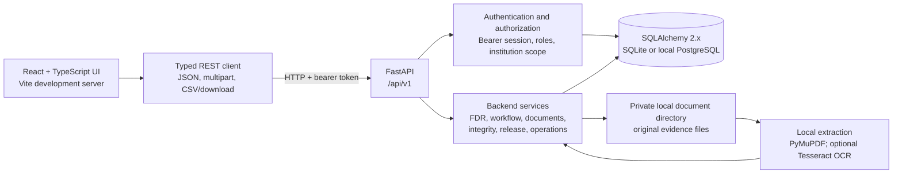

# FDR Sentinel

FDR Sentinel is a local-development prototype for managing AICTE institution security deposits and fixed-deposit receipt (FDR) records. It brings together institution-scoped records, evidence documents, scrutiny and approval workflows, explainable integrity checks, maturity operations, release-request eligibility, reports, and audit history.

This is a **local prototype, not a production or official verification system**. Demo institutions, users, FDRs, issuers, and findings are fictional. Seeded document rows are metadata fixtures and have no uploaded document bytes. The application has no bank connection, live bank verification, payment or fund-transfer capability, cloud service, or deployment configuration. Extraction and integrity results are leads for authorized human review, not proof of fraud or authenticity. The demo does not need an LLM API key.

## Contents

- [System architecture](#system-architecture)
- [Application and data pipelines](#application-and-data-pipelines)
- [Roles and end-to-end workflows](#roles-and-end-to-end-workflows)
- [Local setup and run](#local-setup-and-run)
- [API and user-interface map](#api-and-user-interface-map)
- [Configuration and local data](#configuration-and-local-data)
- [Tests and operational commands](#tests-and-operational-commands)
- [Known limitations](#known-limitations)

## System architecture

The application is a local, three-part system: a browser-based React client, a FastAPI JSON API, and local persistence/evidence storage. The browser calls the API directly; the backend is responsible for identity, authorization, institution scoping, validation, lifecycle rules, persistence, and audit records.



### Components and responsibilities

| Layer | Implementation | Responsibility |
|---|---|---|
| Browser application | React 19, TypeScript, Vite, Tailwind CSS, Radix/shadcn-style components, Lucide icons, React Router | Login, dashboards, institution and FDR workspaces, document review, queues, release requests, reports, notifications, and audit views. The UI gates routes for usability, but is not an authorization boundary. |
| API client | `frontend/src/lib/api.ts`, typed contracts in `frontend/src/types/api.ts` | Adds the configured API prefix and bearer token, serializes JSON and multipart requests, handles API/network errors, expires an unauthorized browser session, and exposes typed operations to pages. |
| HTTP API | FastAPI under `backend/app/api/`, schemas in `backend/app/schemas/` | Defines REST endpoints, request/response validation, authentication dependencies, role checks, institution-scoped access, and consistent API errors. |
| Business services | `backend/app/services/` | Implements lifecycle transitions, release eligibility, document storage/extraction, deterministic integrity rules, audit/history recording, dashboards, reminders, and report behavior outside React components. |
| Persistence | SQLAlchemy 2.x models in `backend/app/models/`, Alembic migrations in `backend/migrations/` | Stores institution and FDR data, users and sessions, document metadata and extracted candidates, workflow/audit history, findings/checks, notifications, and release requests/decisions. |
| Evidence storage | Private local directory, default `backend/data/documents/` | Stores uploaded original bytes separately from database rows and frontend assets. Database metadata includes generated storage keys and SHA-256 hashes; API responses do not disclose filesystem names. |
| Local jobs | `backend/scripts/` | Provides deterministic synthetic seeding, development account seeding, guarded demo reset, integrity evaluation, and repeat-safe maturity/overdue notification generation. |

The API is versioned under `/api/v1`. The Vite development server normally runs on `127.0.0.1:5173`; FastAPI normally runs on `127.0.0.1:8000`. SQLAlchemy connects to either a local PostgreSQL database or SQLite. The default SQLite file is relative to the backend process working directory, so the documented commands run Alembic and FastAPI from `backend/`.

### Data provenance and evidence model

FDR Sentinel keeps distinct information types separate:

- **Institution-submitted:** declared FDR fields and institution responses.
- **Extracted:** candidate field values parsed from uploaded files. A missing candidate is represented as missing, not inferred.
- **System-generated:** integrity findings, verification checks, priorities, reminders, and eligibility outcomes.
- **Independently verified:** a data-origin category available in the model, but the prototype does not connect to an independent bank verification provider.
- **Synthetic demo:** seeded illustrative records, identified as fictional.

An FDR record references its documents; the document record stores metadata, extraction state, candidate fields, and a hash, while the original remains a separate private file. A renewal or replacement is a new successor record linked to its predecessor. Workflow events and audit events preserve a history rather than treating the current FDR status as the full record of what happened.

## Application and data pipelines

### 1. Local initialization and demo-data pipeline

1. A developer creates `backend/.venv/`, installs the pinned backend requirements there, and creates a local root `.env` from `.env.example`.
2. Alembic applies the ordered migrations from `backend/migrations/versions/` to the configured database.
3. `scripts.seed_demo` inserts deterministic, fictional institution, obligation, instrument, and example metadata records. The seed is idempotent.
4. `scripts.seed_users` creates or refreshes fictional logins only when `APP_ENV=development`; the password is entered locally through `FDR_DEMO_PASSWORD` and is not part of the repository.
5. FastAPI and Vite run as separate local processes. The UI reads the API base URL from `frontend/.env.local`, defaulting to `http://127.0.0.1:8000`.

The demo reset utility is specifically guarded for a development SQLite database under the backend project directory. It creates a timestamped backup before rebuilding the database and does not delete uploaded documents. Do not use it for PostgreSQL.

### 2. Login and authenticated-request pipeline

1. A user signs in through `POST /api/v1/auth/login`.
2. The API verifies the stored Argon2 password hash and returns a signed, short-lived bearer token. The token is backed by a persisted session that can be revoked.
3. The frontend keeps the token in browser `sessionStorage` and sends it as a bearer authorization header on API requests. It calls `/auth/me` when restoring the authenticated UI.
4. Backend dependencies resolve the authenticated user and apply role restrictions. Institution-user reads and writes are constrained to the user's own institution; requesting another institution's FDR by ID returns not found rather than exposing its existence.
5. Logout revokes the stored session. The frontend clears an expired/unauthorized session when the API returns HTTP 401.

The UI's route gates are for navigation and user experience. The backend repeats the meaningful access and role checks for every protected operation.

### 3. FDR record and scrutiny pipeline

1. **Draft creation:** an institution user creates an instrument. The server sets its status to `draft`; the client cannot choose lifecycle or verification status.
2. **Draft maintenance:** institution users can edit instrument fields only while the record is in `draft` or `clarification_required`. Changes are recorded in audit history.
3. **Submission:** an institution user submits the draft. The API validates the transition and records a workflow event and audit event.
4. **Scrutiny:** a scrutiny officer records a recommendation or requests clarification. Clarification moves the record to `clarification_required`; a recommendation leaves it `under_scrutiny`.
5. **Clarification response:** the owning institution user responds to the specific open clarification event. The response is linked to that request and returns the instrument to `submitted` for another scrutiny pass.
6. **Final decision:** an approving authority records the final approval or rejection and its rationale. Scrutiny recommendations are not final decisions.
7. **History:** workflow events show the case timeline and statuses; audit events capture consequential actions and redacted summaries. These histories are separate from the current instrument fields.

The implemented lifecycle values are `draft`, `submitted`, `under_scrutiny`, `clarification_required`, `approved`, `rejected`, `release_pending`, `released`, `matured`, and `superseded`. Valid actions depend on the current state; invalid transitions are rejected by the backend rather than silently accepted.

### 4. Document upload, preservation, and extraction pipeline

1. An institution user uploads a PDF, JPEG, PNG, or WebP file to an instrument they are allowed to access. The default upload limit is 15 MiB.
2. The backend validates the detected file content and size, generates a storage name, writes the original to private local storage, computes a SHA-256 hash, and stores document metadata. A new upload creates another document record; it does not overwrite a previous original.
3. For text-based PDFs, PyMuPDF reads the text locally. Deterministic labeled-field matching produces candidate bank, branch, reference, amount, issue/maturity date, and beneficiary values where found.
4. Extracted values are stored separately from declared instrument values. Comparable values are marked as matching or differing; a missing or unknown value is not reported as a mismatch. These candidates are not calibrated confidence scores or bank confirmations.
5. For scanned documents, local Tesseract OCR is optional and disabled by default. When enabled, the adapter processes up to five PDF pages with a per-page timeout and does not write rendered pages to temporary image files. If OCR is disabled/unavailable, the extraction state reports `ocr_required` rather than fabricating fields.
6. A detected mismatch can create an open verification check for human review. Authorized scrutiny officers can record a review of an extracted field. Upload, extraction, review, and download activity is reflected in the instrument history.
7. Authorized users retrieve the original through an authenticated API download. The file remains in private storage and outside frontend public assets.

### 5. Integrity scan and review pipeline

An authorized scrutiny officer can invoke `POST /api/v1/integrity/scan`. The deterministic local rules inspect the available record set and persist explainable findings, including:

- Exact duplicate document hashes.
- Repeated normalized instrument references.
- Similarity candidates from extracted document text.
- Extracted amount, beneficiary, and date discrepancies.
- Missing required documents.
- Approaching maturity without a successor.
- Renewal/replacement lineage conflicts.
- Pending release requests with unresolved required checks.

Each finding includes its rule and supporting context so a reviewer can understand why it appeared. Queue scores are deterministic triage points based on factors such as severity, open status, maturity proximity, and unresolved release conditions; they are **not probabilities**. Findings and text-similarity matches are review leads, not proof of fraud, forgery, authenticity, or intent. A scrutiny officer can review or dismiss a finding with notes. Institution users cannot inspect cross-institution duplicate evidence.

### 6. Renewal, replacement, maturity, and notification pipeline

- A renewal or replacement is created as a new draft successor linked to its predecessor. Prior records and evidence are preserved. The predecessor is superseded only when the successor is approved.
- Dashboard and report queries calculate maturity/date-driven work directly from stored dates; those views do not depend on a scheduler.
- The repeat-safe `scripts.generate_reminders` job can advance approved instruments past maturity into `matured`, create configured advance maturity reminders, and create deduplicated in-app escalations for overdue maturity/workflow actions.
- Notification deduplication keys prevent repeated job runs from creating duplicate notifications for the same reminder/escalation. Notifications are addressed to users and can only be read or marked read by their recipient.
- The job does not send email or SMS. A macOS LaunchAgent installer is provided as an optional local schedule; it is not required for the application or dashboard to run.

### 7. Release/refund request and decision pipeline

1. An eligible user creates a release request for an instrument.
2. The API evaluates current instrument state and effective configured rules, including required verification checks and other release conditions, and persists an explainable eligibility result.
3. A blocked evaluation cannot be treated as approval. Conditions must be satisfied and/or reviewed as required by the workflow.
4. An approving authority explicitly records an approve, reject, or return decision with disposition/rationale. Eligibility evaluation and authorization are separate steps.
5. The application records a request/decision and audit trail only. **It does not initiate a bank instruction, release funds, or transfer money.**

### 8. Dashboard, reporting, and audit pipeline

- Dashboard summary and queues read current FDR, workflow, finding, verification, maturity, and release-request state from the database. Filters include institution, maturity-date range, lifecycle status, and operational priority where supported.
- JSON reports and matching CSV exports cover instruments, upcoming maturities, pending verification, and release requests. Report filters and pagination are applied server-side. CSV fields beginning with spreadsheet formula characters are escaped.
- Per-instrument history is scoped to the instrument. The paginated global audit feed is restricted to authorized internal roles and intentionally omits before/after payloads. Audit records are not a substitute for external regulatory or bank records.

## Roles and end-to-end workflows

| Role | Intended local prototype access |
|---|---|
| `institution_user` | Manage its own institution's drafts, upload evidence, submit records, respond to clarification, view its scoped records/history, and create/track release requests. |
| `scrutiny_officer` | Read cross-institution review records, run integrity scans, review findings and extracted fields, and perform scrutiny/clarification actions. |
| `approving_authority` | Read review records and record final instrument decisions and release-request decisions. |
| `auditor` | Read permitted cross-institution records, audit/history, queues, and reports without making scrutiny or approval decisions. |
| `admin` | Explicit global read access; admin is not implicitly a scrutiny officer or approving authority. |

These are prototype roles, not a production identity or institutional access-control integration. In particular, internal review roles have broad cross-institution read access and case assignment is not implemented. Backend role and tenant checks are authoritative; frontend role gating alone is not security.

## Local setup and run

### Prerequisites

- Python 3.11 or newer.
- Node.js 20 or newer and npm.
- PostgreSQL 15 or newer only if using PostgreSQL; SQLite is the default local fallback.
- Use only `backend/.venv/` for Python dependencies and commands. Do not install Python packages globally.

### 1. Create the local environment

Run from the repository root:

```sh
if [ ! -x backend/.venv/bin/python ]; then python3 -m venv backend/.venv; fi
backend/.venv/bin/python -m pip install -r backend/requirements.txt
if [ ! -f .env ]; then cp .env.example .env; fi
```

Set a unique local JWT signing key in the ignored `.env` file:

```sh
backend/.venv/bin/python -c 'import secrets; print(secrets.token_hex(32))'
```

Copy the generated value into `JWT_SECRET_KEY` in `.env`. The provided configuration uses SQLite (`sqlite:///./fdr_sentinel.db`) and local development mode. If using PostgreSQL instead, start your local PostgreSQL service, create a local database/user, and set `DATABASE_URL` to its local DSN. PostgreSQL is an available option but is not required for the default demo.

### 2. Migrate and seed the database

```sh
cd backend
.venv/bin/alembic upgrade head
.venv/bin/python -m scripts.seed_demo
```

Create or refresh fictional development accounts. The seed requires a local password of at least 12 characters, does not echo it, and is allowed only in development mode:

```sh
read -s "FDR_DEMO_PASSWORD?Enter a local demo password (12+ characters): "
echo
export FDR_DEMO_PASSWORD
.venv/bin/python -m scripts.seed_users
unset FDR_DEMO_PASSWORD
```

Demo emails use the reserved `.invalid` domain:

- Institution users: `institution01@fdr-sentinel.invalid` through `institution05@fdr-sentinel.invalid`
- Scrutiny: `reviewer@fdr-sentinel.invalid`
- Approval: `approver@fdr-sentinel.invalid`
- Audit: `auditor@fdr-sentinel.invalid`
- Admin: `admin@fdr-sentinel.invalid`

All seeded accounts share the local password you just entered. No password is included in the repository. To return to the repository root, run `cd ..`.

### 3. Start backend and frontend

In terminal 1, from the repository root:

```sh
cd backend
.venv/bin/uvicorn app.main:app --reload --host 127.0.0.1 --port 8000
```

The API health endpoint is <http://127.0.0.1:8000/api/v1/health>; interactive API docs are at <http://127.0.0.1:8000/docs>.

In terminal 2, from the repository root:

```sh
cd frontend
if [ ! -f .env.local ]; then cp .env.example .env.local; fi
npm ci
npm run dev
```

Open the Vite URL printed in the terminal (normally <http://127.0.0.1:5173>). The frontend API base URL defaults to `http://127.0.0.1:8000`; set `VITE_API_BASE_URL` in `frontend/.env.local` and restart Vite if the API uses another local address. Do not put secrets in frontend environment variables. Stop either process with **Ctrl+C**.

### Rebuilding the synthetic SQLite demo

Stop the backend before resetting. From the repository root:

```sh
cd backend
.venv/bin/python -m scripts.reset_demo
```

The reset command refuses non-development, non-SQLite, and out-of-project database targets. It makes a timestamped SQLite backup before replacement, reapplies migrations, and reseeds synthetic records. It does not delete private uploads. Recreate user accounts afterwards with `scripts.seed_users`. Do not use this command for PostgreSQL.

## API and user-interface map

All API routes are under `/api/v1`; the OpenAPI interface at `/docs` is the interactive source for exact request/response schemas.

| API area | Representative routes | Purpose |
|---|---|---|
| Health and authentication | `GET /health`, `POST /auth/login`, `GET /auth/me`, `POST /auth/logout` | Check API/database availability and manage signed, revocable local sessions. |
| Institutions and FDRs | `/institutions`, `/institutions/{id}`, `/institutions/{id}/obligations`, `/fdrs`, `/fdrs/{id}` | List scoped records, create/update drafts, and read instrument details. |
| Workflow and history | `/fdrs/{id}/submit`, `/scrutiny`, `/clarifications/{event_id}/respond`, `/decision`, `/successors`, `/fdrs/{id}/history` | Perform guarded lifecycle actions and inspect event history. |
| Documents | `/fdrs/{id}/documents`, `/documents/{document_id}/download`, `/documents/{document_id}/fields/{field_name}/review` | Upload/list evidence, retrieve authorized originals, and record human review of extracted fields. |
| Integrity | `/integrity/scan`, `/integrity/queue`, `/integrity/findings`, `/integrity/findings/{id}/review` | Run deterministic rules and manage review outcomes. |
| Dashboard and operations | `/dashboard/summary`, `/dashboard/queue`, `/dashboard/pending-scrutiny`, `/notifications` | Read actionable queues and recipient-scoped notifications. |
| Release requests | `/fdrs/{id}/release-requests`, `/release-requests/{id}`, `/release-requests/{id}/evaluate`, `/release-requests/{id}/decision` | Request and evaluate eligibility, then record an explicit authorized decision. |
| Reports and audit | `/reports/instruments`, `/reports/upcoming-maturities`, `/reports/pending-verification`, `/reports/release-requests`, `/audit/events` | Read filterable JSON/CSV reports and the restricted redacted global audit feed. |

The React application provides `/` dashboard, `/institutions`, `/institutions/:id`, `/fdrs`, `/fdrs/:id`, `/scrutiny`, `/scrutiny/:id`, `/pending-scrutiny`, `/action-queue`, `/releases`, `/notifications`, `/reports`, and `/audit` views. Authentication is required for application routes; role-specific page gating complements, but does not replace, API authorization.

## Configuration and local data

Root `.env` is read by backend settings. Common values:

| Setting | Default | Description |
|---|---|---|
| `DATABASE_URL` | `sqlite:///./fdr_sentinel.db` | Local SQLite or PostgreSQL SQLAlchemy URL. The SQLite path is resolved from the backend process working directory. |
| `JWT_SECRET_KEY` | Placeholder in `.env.example` | Replace with a unique local signing key; never commit `.env`. |
| `JWT_ACCESS_TOKEN_MINUTES` | `15` | Short-lived bearer token duration. |
| `CORS_ORIGINS` | `http://localhost:5173,http://127.0.0.1:5173` | Allowed local browser origins. |
| `DOCUMENT_STORAGE_DIR` | `./backend/data/documents` | Private local original-document directory, resolved from the repository root. |
| `MAX_DOCUMENT_SIZE_BYTES` | `15728640` | Default upload cap (15 MiB). |
| `MATURITY_REMINDER_WINDOWS_DAYS` | `30,15,7` | Comma-separated positive day windows for maturity reminders. |
| `ACTION_OVERDUE_DAYS` | `7` | Age threshold for overdue workflow action escalation. |
| `LOCAL_OCR_ENABLED` | `false` | Opt-in local Tesseract OCR adapter. |

The frontend uses `frontend/.env.local` for `VITE_API_BASE_URL` only. Environment files, local databases and SQLite sidecars, private uploaded evidence, Python environments/caches, `node_modules/`, and build output are excluded by `.gitignore`. Never place real financial, institutional, or personal data in this prototype.

To enable optional local OCR on macOS, install Tesseract with `brew install tesseract`, set `LOCAL_OCR_ENABLED=true` in the ignored root `.env`, and restart FastAPI. OCR remains a local extraction aid and every candidate needs human review.

## Tests and operational commands

From the repository root:

```sh
backend/.venv/bin/python -m pytest
backend/.venv/bin/python -m compileall backend/app backend/migrations
cd frontend
npm test
npm run build
```

Run the maturity/overdue operations pipeline manually from `backend/`:

```sh
.venv/bin/python -m scripts.generate_reminders
```

It is safe to rerun and does not send email or SMS. Dashboard and report date calculations continue to work even when this job has not run. On macOS, `backend/scripts/install_macos_reminder_schedule.sh` can install an optional daily 09:00 LaunchAgent; it is not a required application service.

The deterministic synthetic integrity-evaluation report can be regenerated from `backend/` with:

```sh
.venv/bin/python -m scripts.integrity_evaluation
```

## Known limitations

- Local development prototype only; no production deployment or production secret-management model.
- No institutional identity provider, SSO, or external bank verification.
- No payment rail, bank instruction, automatic approval, fund release, or money transfer.
- No cloud object storage, external OCR service, LLM requirement, email/SMS delivery, message broker, or vector database.
- OCR is optional local Tesseract only; otherwise scanned content reports `ocr_required`.
- Synthetic records and document metadata do not constitute real evidence or bank confirmation.
- Integrity rules and extracted-field differences are explainable review candidates, not fraud determinations.
- Internal reviewer visibility is broad; case assignment and a production-grade least-privilege model are not implemented.
- The data model has an independently-verified provenance category, but no independent verification integration is configured.

See [docs/architecture.md](docs/architecture.md) for the architecture note, [backend/README.md](backend/README.md) for backend route and operational details, [docs/demo-script.md](docs/demo-script.md) for a short walkthrough, [docs/threat-model.md](docs/threat-model.md) for local prototype risks, and [docs/TEST_RESULTS.md](docs/TEST_RESULTS.md) for the latest recorded test results and limitations.
