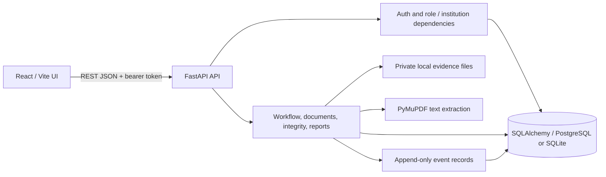

# FDR Sentinel local architecture

## Components

- **Browser UI:** React 19, TypeScript, Vite, Tailwind CSS, Radix/shadcn-style primitives, and Lucide icons. Vite serves the development UI at `127.0.0.1:5173`; its typed API client calls the REST API.
- **API:** FastAPI under `backend/app/`, versioned at `/api/v1`. Pydantic schemas validate requests and responses. API dependencies authenticate bearer tokens and enforce role and institution scope. Services contain lifecycle, release eligibility, extraction, integrity, audit and reporting behavior.
- **Persistence:** SQLAlchemy 2.x models, Alembic migrations, and either local PostgreSQL or SQLite fallback. The default SQLite file is created in the `backend/` working directory. Workflow, audit and verification history rows are separate from current record state.
- **Evidence storage:** uploaded originals are outside frontend assets in private local storage (`DOCUMENT_STORAGE_DIR`, default `backend/data/documents`). Database rows store metadata, generated storage keys, hashes and extracted candidates; the instrument row does not contain binary content.
- **Local utilities:** deterministic `scripts.seed_demo`, development-only `scripts.seed_users`, backup-before-reset `scripts.reset_demo`, reminder generation and integrity evaluation. No resident scheduler is required for date-driven dashboard results.

## Primary data flow

1. A development-seeded user authenticates; the API returns a short-lived signed bearer token backed by a revocable database session. The API derives actor, role and optional institution from that session, never from a client-supplied actor field.
2. An institution user creates a draft instrument within their own institution. Backend queries scope institution-user requests and ID lookups to that institution.
3. The user uploads evidence as a separate document. The server validates media type/content and size, generates a storage key, stores the original privately, calculates SHA-256, and persists metadata. Text PDFs are processed locally; extracted candidates remain separate from declared instrument values. Unsupported OCR work reports `ocr_required` rather than inventing fields.
4. A submit action and subsequent scrutiny/clarification/decision actions pass through explicit backend transition checks. Each consequential action writes workflow history and a concise audit event in the transaction. Final decisions require an approving authority. Release eligibility is evaluated from current state and rules, but a successful check still requires an authorized human decision and does not transfer funds.
5. Integrity rules compare available records and evidence; findings include identifiers, evidence, expected/observed values and rule versions. Similarity and mismatch findings are review candidates, not fraud or authenticity assertions.
6. Dashboard and report endpoints query the database and instrument dates directly. The local reminder command creates deduplicated in-app notifications; the dashboard does not depend on it running.

## Local configuration and boundaries

Root `.env` configures database URL, signing key, CORS, private document path and reminder behavior. Frontend `.env.local` only configures `VITE_API_BASE_URL` and must not contain secrets. The local CORS allowlist permits both `localhost:5173` and `127.0.0.1:5173` by default. There are no cloud services, bank APIs, payment rails, LLM API requirements, message brokers, vector stores or deployment resources.

Synthetic seed data is identified as synthetic; seeded document rows are metadata fixtures without document bytes. A reset is restricted to a development SQLite file in the backend project directory and first creates a timestamped backup. Reset does not erase private uploaded documents.

## Known gaps

This architecture is a local prototype. It has no institutional identity provider, production secret management, object storage, case assignment, configured OCR/Tesseract, live bank verification, fund transfer, global audit feed or production deployment model. The draft update endpoint and full browser-automated workflow are also incomplete/unverified. Do not treat local extraction or rule outcomes as official verification.
